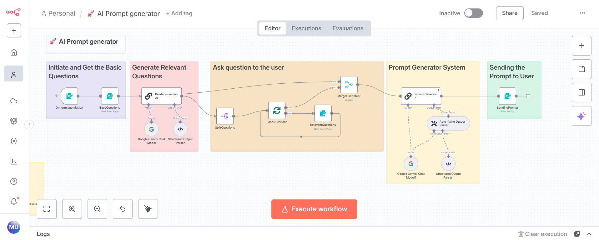

# n8n Projects

A curated collection of practical n8n automation workflows, AI agents, API integrations, and business automation systems.

Built and maintained by **Muhammad Umar**, AI Automation Developer.

- 🌐 [Portfolio](https://umardev.ai.studio)
- 🏢 [Xetomation](https://xetomation.si)
- 💼 [LinkedIn](https://www.linkedin.com/in/muhammad-umar-56a447257)

## Project categories

| Category | What you'll find |
|---|---|
| [AI Agents](./AI-Agents/) | AI assistants, prompt engineering, LLM-powered workflows |
| [Lead Generation](./Lead-Generation/) | Prospect discovery, enrichment, lead research |
| [Marketing Automation](./Marketing-Automation/) | Content, social media, and campaign workflows |
| [SEO Automation](./SEO-Automation/) | Technical and on-page SEO workflows |
| [Business Automation](./Business-Automation/) | CRM, operations, and customer support |
| [Data Automation](./Data-Automation/) | Data processing, reporting, and spreadsheet workflows |
| [Utility Workflows](./Utility-Workflows/) | Reusable helpers and integrations |

## Featured project

### AI Prompt Generator

A guided n8n workflow that collects an initial idea, asks AI-generated follow-up questions, and produces a structured prompt using Google Gemini.

- **Workflow:** [🚀 AI Prompt generator.json](./AI-Agents/AI-Prompt-Generator/workflow.json)
- **Documentation:** [Project README](./AI-Agents/AI-Prompt-Generator/README.md)
- **Screenshot:** [Workflow screenshot](./AI-Agents/AI-Prompt-Generator/screenshot.png)

## Importing a workflow

1. Open your n8n instance.
2. Create or open a workflow and use **Import from File**.
3. Select the project's JSON file.
4. Configure your own credentials and environment-specific settings.
5. Review node parameters, expressions, URLs, and permissions.
6. Test with sample data before activating the workflow.

## Security

- Never commit API keys, access tokens, passwords, private URLs, or exported credential secrets.
- Reconnect credentials inside your own n8n instance after importing.
- Review every workflow for personal data, webhook URLs, and environment-specific values before production use.

## Project documentation

Each project folder should include:
- `README.md` with purpose, prerequisites, setup, and testing instructions
- `workflow.json` exported from n8n with secrets removed
- `screenshot.png` showing the workflow or its output, where useful
- Optional `assets/` for supporting diagrams and examples

## License

No open-source license has been selected yet. Unless a license is added, all rights remain reserved by the copyright holder. Please contact the author before reusing or redistributing project files.

---
Made with n8n, APIs, and AI.
